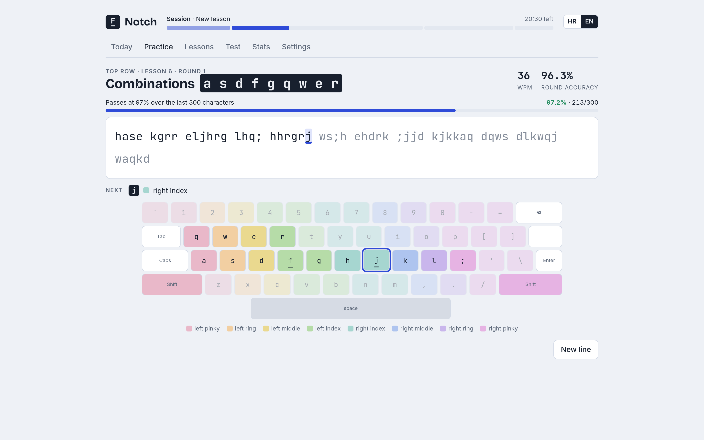
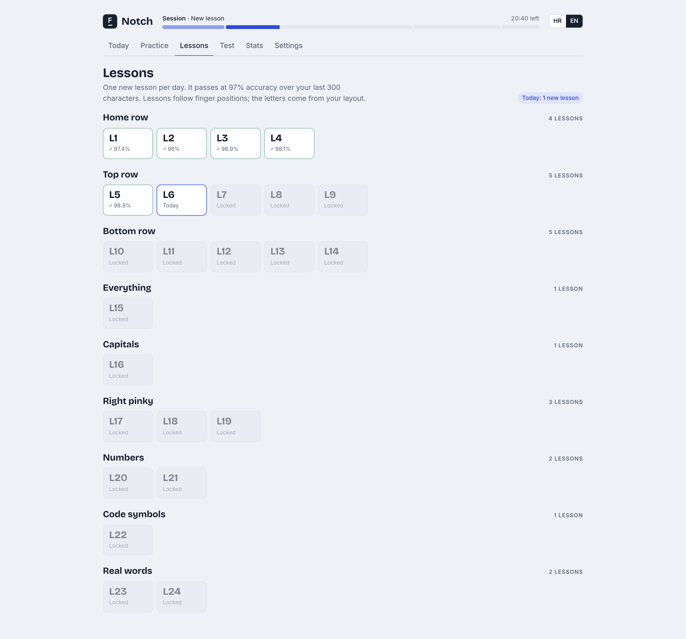
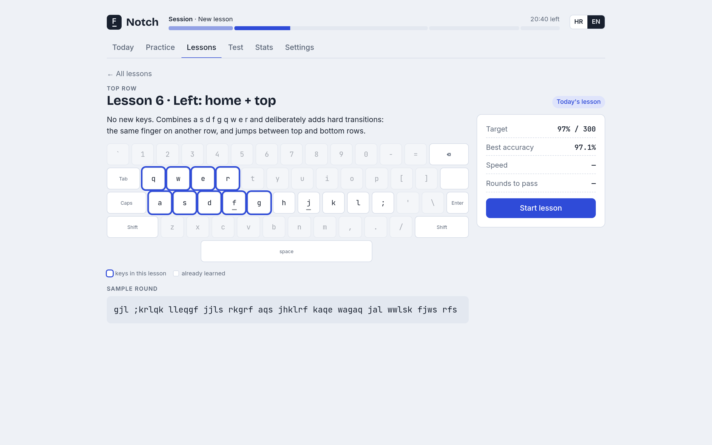
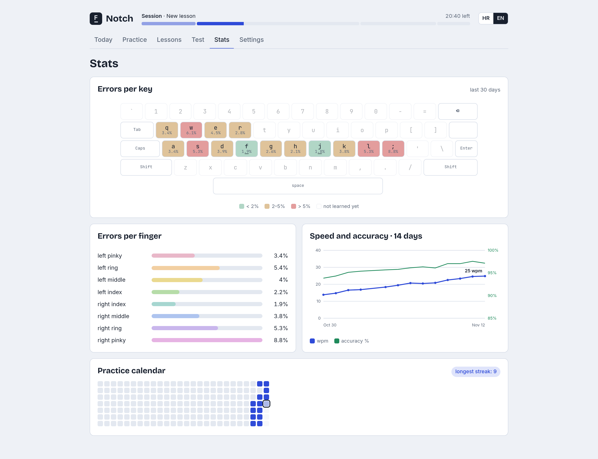
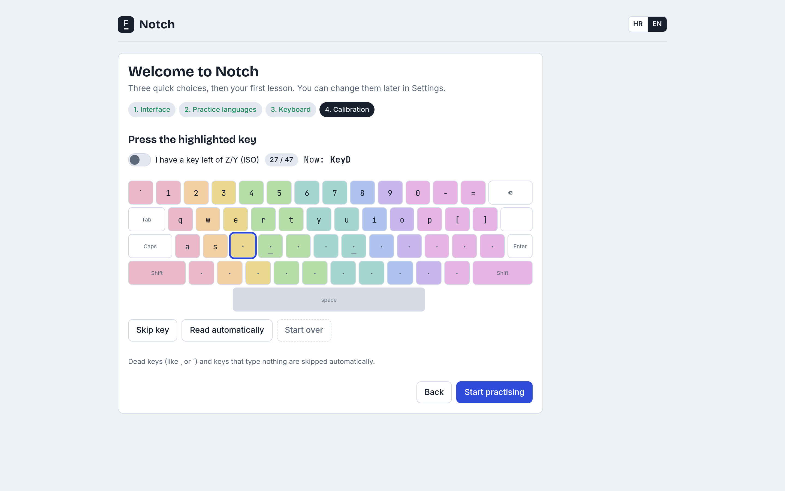

# Notch

Notch teaches ten-finger touch typing in small daily steps. It's named after
the little bumps on the F and J keys that bring your fingers home.

<picture>
  <source media="(prefers-color-scheme: dark)" srcset="docs/screenshots/practice-dark.png">
  
</picture>

It's built for people who already type fast with a bad technique and want to
fix it without straining their hands. So Notch's main job is to stop you from
rushing:

- **Accuracy before speed.** A lesson passes at 97% accuracy over your last
  300 characters. A wrong key doesn't move on until you press the right one.
  In early lessons, going over your speed limit tints the wpm amber, and
  Notch asks you to slow down only when the speed starts costing accuracy.
- **One new lesson per day.** Muscle memory settles overnight, so you can't
  binge ahead.
- **A fixed 30-minute session.** 5 min warm-up, 15 min new lesson, 7 min weak
  keys, 3 min test. The clock only runs while you type.
- **Combinations, not isolated keys.** Drills are random 2–6 character groups
  that mix the new keys with everything learned and deliberately include hard
  transitions (same finger on another row, top-to-bottom jumps).

Lessons are defined by physical key position, so they work on any keyboard
layout. Croatian QWERTZ and US QWERTY are built in; any other layout can be
calibrated in about two minutes.

## Screenshots

**Lessons.** One card per lesson; passed, today's and locked at a glance.



**A lesson.** What it trains, which keys, a sample round and your best results.



**Stats.** Error rate per key and per finger, speed and accuracy over two weeks, and a practice calendar.



**Calibration.** For any layout that isn't built in: press each highlighted key once.



## Run it

```sh
git clone https://github.com/<you>/notch.git
```

Then open `index.html` in Chromium, Chrome or Firefox (double-click works).
There's nothing to install or build, and it works offline.

The first run asks for your interface language, the languages you want to
practise (for tests and real-word lessons), and your keyboard. You can change
all of it later in Settings.

To skip first run, copy `config.example.js` to `config.local.js` and set your
choices. That file is ignored by git.

## Your progress

Progress is stored in your browser's local storage, on this computer only.
Back it up from **Settings → Backup → Export**, which downloads
`notch-backup-YYYY-MM-DD.json`. **Import** restores it (in any browser, on
any computer) and replaces what's there. A calibrated layout is part of the
backup.

## Contributing

New keyboard layouts and languages are very welcome. See
[CONTRIBUTING.md](CONTRIBUTING.md). Tests run with `node --test` (Node 18+,
no dependencies).

## Licence

MIT. Bundled fonts (Inter, JetBrains Mono, Bricolage Grotesque) are under the
SIL Open Font License; see `fonts/`.
